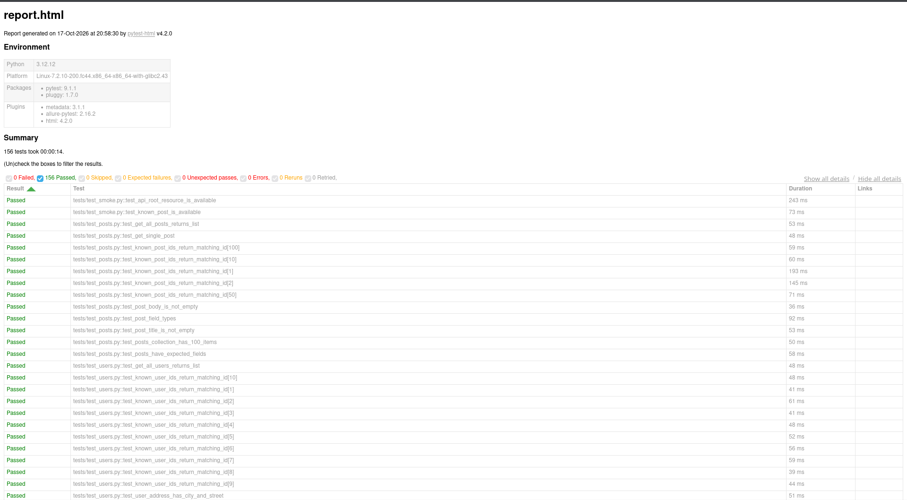
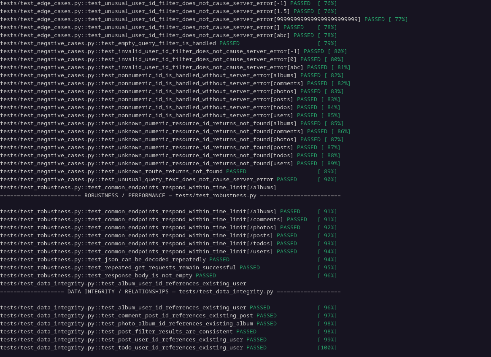

# REST API Testing Framework

A Python-based REST API testing framework built with **Pytest** and **Requests**. It validates API responses, checks JSON Schemas, and covers positive, negative, and edge-case scenarios.

## Features

- Automated REST API testing
- Parameterized tests with multiple input values
- Positive, negative, and edge-case scenarios
- HTTP status code and response validation
- JSON Schema validation
- Data integrity and relationship checks
- Response time checks
- HTML and Allure reporting
- GitHub Actions CI integration

## Tech Stack

- Python
- Pytest
- Requests
- JSON Schema
- Allure
- pytest-html
- GitHub Actions

## Test Results

**156 passed · 0 failed · 0 errors · 0 skipped**

Total execution time: approximately 14 seconds.

### HTML Test Report



### Terminal Test Execution



## Installation

### 1. Create a virtual environment

```bash
python -m venv .venv
```

### 2. Activate the environment

Linux / macOS:

```bash
source .venv/bin/activate
```

Windows:

```bash
.venv\Scripts\activate
```

### 3. Install dependencies

```bash
pip install -r requirements.txt
```

## Running Tests

Run the test suite using the project runner:

```bash
python run_tests.py
```

Alternatively, run Pytest directly:

```bash
pytest
```

The project generates an HTML report and Allure results according to the configured output paths.

## Testing Scope

The framework tests JSONPlaceholder resources, including posts, users, comments, albums, photos, and todos.

It verifies:
- HTTP status codes and response structure
- Required fields and data types
- JSON Schema compliance
- Valid, invalid, and unusual input values
- Relationships between API resources
- Response times for selected endpoints

## API Under Test

[JSONPlaceholder](https://jsonplaceholder.typicode.com/) is a public fake REST API designed for testing and prototyping.

**Note:** Write operations such as `POST`, `PUT`, `PATCH`, and `DELETE` are simulated. Successful responses do not guarantee persistent changes to server data.

## Project Goals

This project demonstrates practical skills in REST API testing, test automation, parameterization, response validation, JSON Schema, reporting, and continuous integration.
