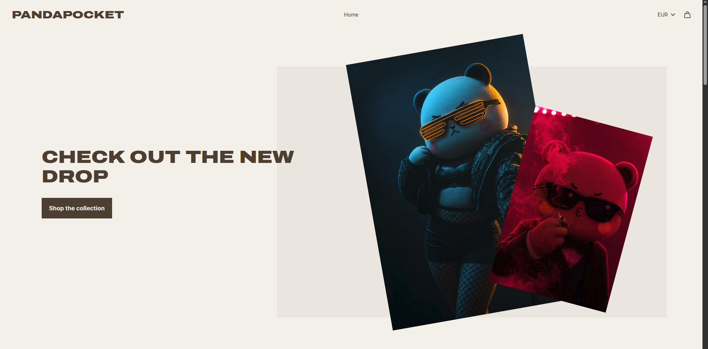
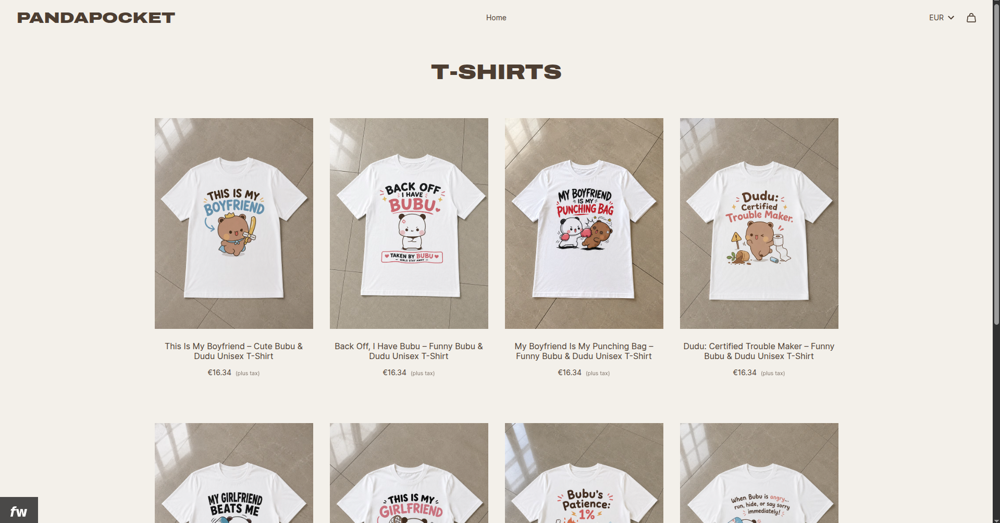
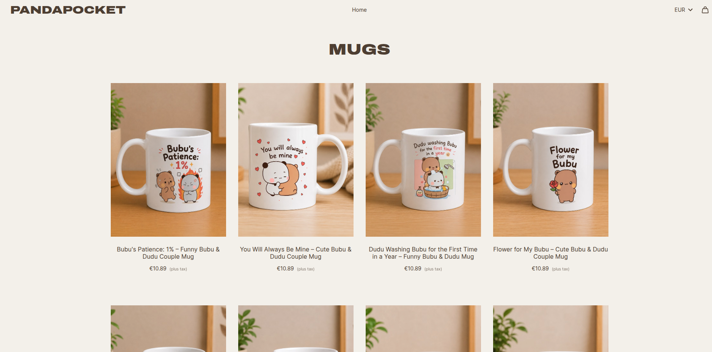
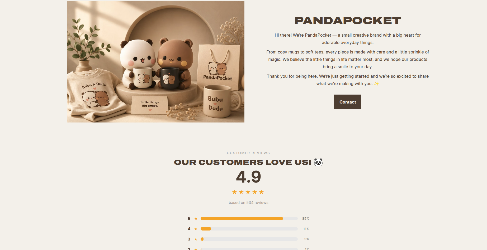
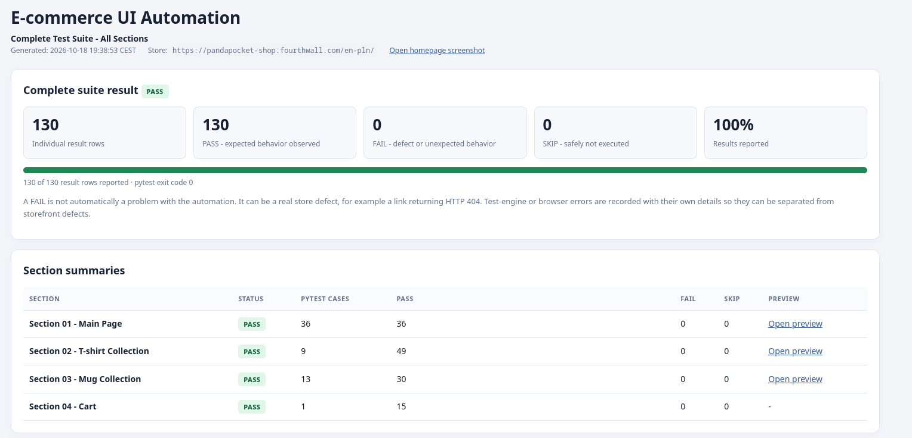

# E-commerce UI Automation

Automated UI testing project for **PandaPocket**, a Fourthwall storefront selling Bubu & Dudu-themed T-shirts and mugs.

**Store:** [pandapocket-shop.fourthwall.com](https://pandapocket-shop.fourthwall.com/en-pln/)  
**Test stack:** Python · Playwright · pytest · Chromium · HTML/JSON reporting

The goal of this project is to validate key customer journeys, detect storefront defects, capture evidence, and produce clear reports before and after fixes.

---

## Store preview

The first four screenshots show the storefront as a customer sees it: homepage, T-shirt collection, mug collection, and store information.

| Homepage | T-shirt collection |
|---|---|
|  |  |

| Mug collection | Store information and reviews |
|---|---|
|  |  |

---

## What is tested?

### 1. Homepage and navigation
- Homepage loads successfully.
- Main navigation and store collection links work.
- Product cards open the expected product pages.
- Cart can be opened and the user can return to the storefront.
- Contact, Terms of Service, Privacy Policy, and Returns & FAQ links are checked.
- All 17 currency options discovered in the currency selector are tested.

### 2. T-shirt collection
- Collection page loads.
- Each discovered product is opened once.
- Available size options are clicked and checked.

### 3. Mug collection
- Collection page loads.
- Each discovered mug is opened once.
- Available size or capacity options are clicked and checked.
- Product URLs are treated separately, including products with similar names.

### 4. Cart and checkout flow
- Three test products are added to a fresh browser context.
- Cart contents and initial subtotal are verified.
- Quantity is changed and subtotal recalculation is checked.
- A product is removed and the subtotal is checked again.
- Checkout is opened to verify that the next step loads.
- No order is placed and no payment is submitted.
- Test items are removed and the cart is checked for the empty state.

---

## Before and after fixes

Two HTML reports are included to document the debugging process and the final successful run.

| Run | Result | Findings |
|---|---:|---|
| [Before fixes - HTML report](reports/2026-10-18_18-26-23/report.html) | **129 PASS · 2 FAIL** | Contact CTA led to an HTTP 404 page. Two distinct mug URLs had the same visible product title, creating a potential duplicate-title/catalogue issue. |
| [After fixes - HTML report](reports/2026-10-18_19-34-25/report.html) | **130 PASS · 0 FAIL** | All recorded checks passed; pytest exit code was 0. |

### Issues identified and resolved

**1. Broken Contact CTA**

The homepage Contact CTA navigated to `/en-pln/pages/contact`, which returned HTTP 404. The target was changed to the working contact page:

`https://pandapocket-shop.fourthwall.com/contact/`

Evidence: [404 screenshot](screens/screen_5.png) · [Before-fixes report](reports/2026-10-18_18-26-23/report.html)

**2. Duplicate mug title**

The catalogue had two distinct product URLs using the visible title **“Flower for My Dudu”**. This made it unclear which design a customer was viewing. The product names were corrected to distinguish **“Flower for My Bubu”** from **“Flower for My Dudu”**, and the corresponding product URL changed.

Evidence from the earlier report: [Duplicate-title finding](reports/2026-10-18_18-26-23/report.html)

The initial report treated this as a potential catalogue-title defect, not proof that the two product pages were technically duplicates. Both URLs remained independently tested in the mug collection.

### Final result



The final run recorded **130 PASS, 0 FAIL, 0 SKIP**. This means all checks included in that run passed; it does not guarantee that every possible user journey or device/browser combination is defect-free.

---

## Tech stack

- **Python** - test orchestration and helper logic
- **Playwright** - browser automation
- **pytest** - test execution and parametrized checks
- **Chromium** - browser under test
- **HTML and JSON** - test reports and machine-readable results
- **GitHub Actions** - CI workflow configuration

---

## Run locally

Use Python 3.12 or another compatible Python version.

```bash
# Create and activate a virtual environment
python -m venv .venv
source .venv/bin/activate

# Install dependencies
pip install -r requirements.txt

# Install the Playwright browser
playwright install chromium

# Run the complete suite and generate reports
python run_tests.py
```

The runner generates a timestamped directory under `reports/` containing an HTML report, JSON report, and supporting evidence.

> Tests interact with a live third-party storefront. Product availability, page content, prices, and site behavior can change, so results may differ between runs. The cart workflow is designed not to submit an order or payment.

---

## Skills demonstrated

- End-to-end UI test automation
- Test discovery and parametrized testing
- Browser navigation and product-option validation
- Cart state and subtotal verification
- Negative-path detection (HTTP 404)
- Regression testing after storefront changes
- Evidence capture and HTML/JSON reporting
- CI workflow setup

**Project purpose:** demonstrate a practical QA workflow: reproduce an issue, record evidence, correct the underlying storefront/configuration problem, rerun the suite, and document the verified outcome.
