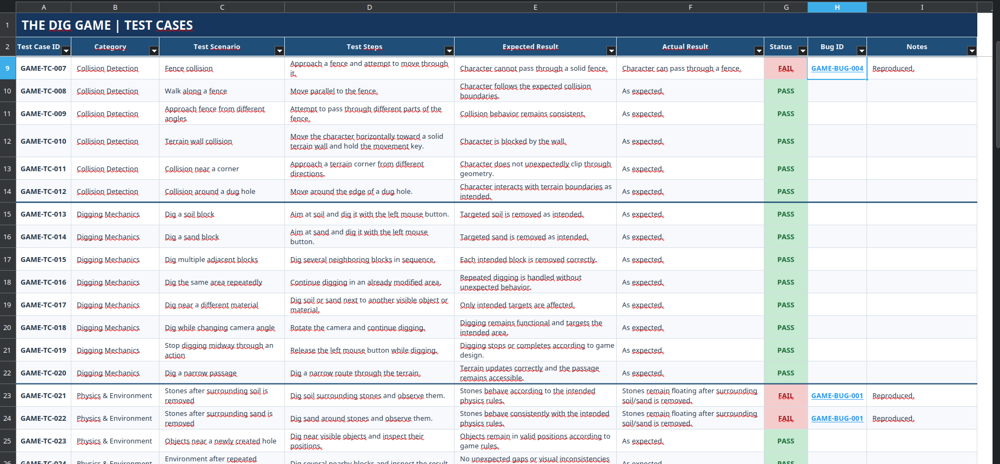
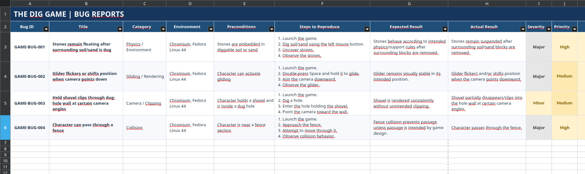
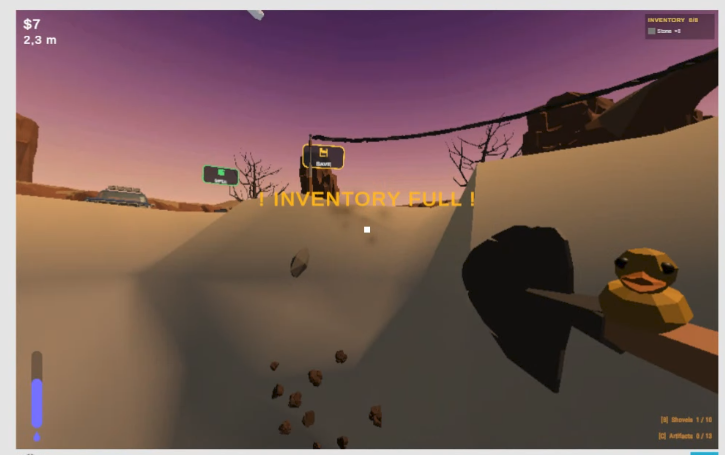
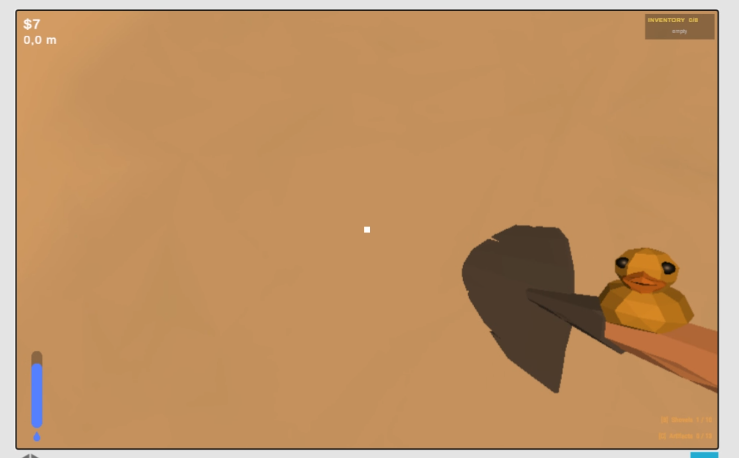

# Manual QA Documentation - Web Game

## Project Overview

This project contains manual QA documentation for **The Dig Game**, a browser-based game available on itch.io.

The goal was to evaluate core gameplay functionality, identify defects, document test results, and provide video evidence for reported issues.

- **Game:** The Dig Game
- **Game URL:** https://louisdesimone.itch.io/the-dig-game
- **Project Type:** Independent QA Portfolio Project
- **Testing Type:** Manual Functional Testing
- **Test Environment:** Chromium on Fedora Linux 44
- **Test Period:** 30-31 July 2026

## Project Contents

### 1. Test Documentation

`The_Dig_Game_Manual_QA_Documentation.xlsx`

The Excel workbook contains three worksheets:

- **Test Info** - project information, test scope, approach, environment, and test summary.
- **Test Cases** - test scenarios, steps, expected and actual results, execution statuses, and related bug IDs.
- **Bug Reports** - detailed defect descriptions, reproduction steps, expected and actual results, and evidence links.

### Test Cases

The test cases document the tested gameplay functionality, expected behavior, actual results, and links to related defects.

### Bug Reports

The bug reports include defect descriptions, reproduction steps, expected and actual results, severity, priority, and links to related test cases.

## 2. Gameplay Screenshots

The following screenshots show the game during testing and provide visual context for the tested environment and gameplay mechanics.

## 3. Evidence Recordings

The `evidence/` directory contains video recordings documenting the four reported defects. The recordings can also be viewed online through Loom.

| Bug ID | Description | Video Evidence |
|---|---|---|
| GAME-BUG-001 | Stones remain floating after surrounding soil or sand is removed. | [Watch on Loom](https://www.loom.com/share/2f43a89beda24e7eaafa518ee307c28d) |
| GAME-BUG-002 | The glider flickers or shifts position when the camera points downward. | [Watch on Loom](https://www.loom.com/share/94ed40c44d074ae2bb5c0c5ff2b18eb6) |
| GAME-BUG-003 | The shovel clips through the wall of a dug hole at certain camera angles. | [Watch on Loom](https://www.loom.com/share/cceded7569134cd092c800289e8acf2c) |
| GAME-BUG-004 | The character can pass through a fence. | [Watch on Loom](https://www.loom.com/share/757b1d11e41040a984076194daea9c52) |

## Test Coverage

The test cases cover the following areas:

- Movement and controls
- Collision detection
- Digging mechanics
- Physics and environment
- Gliding mechanics
- Camera and perspective
- Visual defects and clipping
- Object interaction
- Game UI and input handling
- Stability and edge cases

## Reported Defects

Four unique defects were documented:

1. Floating stones after digging.
2. Glider flickering and incorrect positioning.
3. Shovel clipping through terrain.
4. Character passing through a fence.

Each defect has a corresponding bug ID, reproduction steps, expected and actual results, and supporting video evidence.

## Tools and Technologies

- Chromium
- Fedora Linux 44
- Microsoft Excel / LibreOffice Calc
- Loom for video evidence

## Skills Demonstrated

- Manual functional testing
- Test case design and documentation
- Exploratory testing
- Defect identification and reporting
- Expected versus actual result analysis
- Severity and priority assessment
- Traceability between test cases and bug reports
- Evidence collection and documentation

## Project Purpose

This project demonstrates practical manual QA skills through testing a real browser-based game, documenting test scenarios, identifying defects, and providing reproducible reports supported by video evidence.

**Note:** This is an independent portfolio project and is not affiliated with or endorsed by the game's developer.
