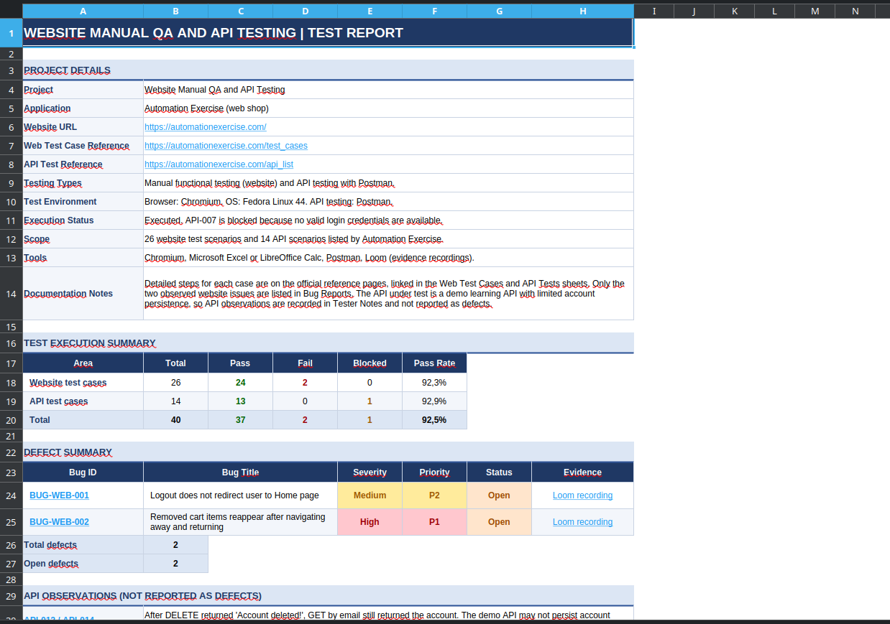
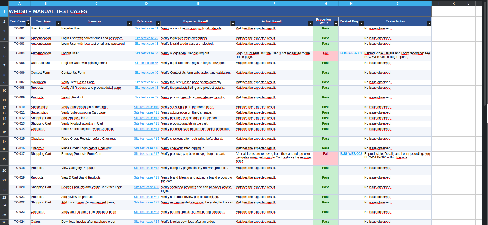
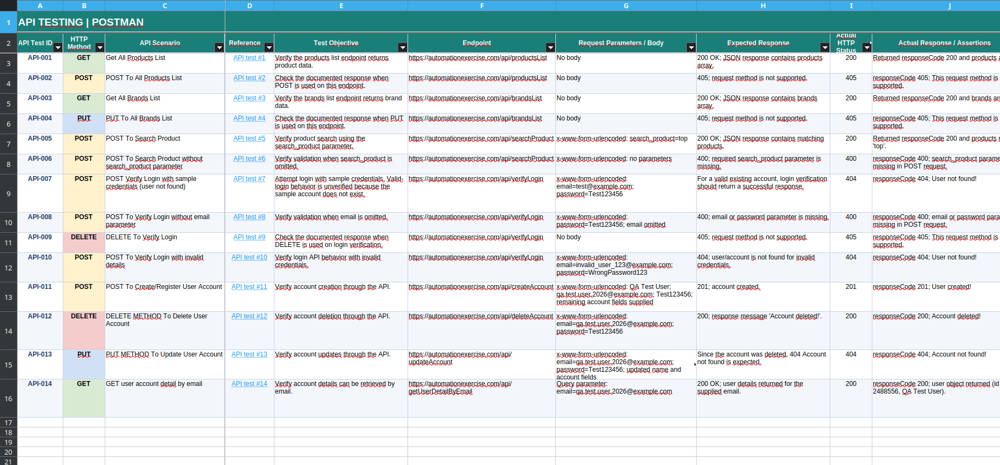
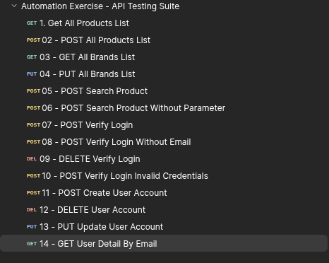
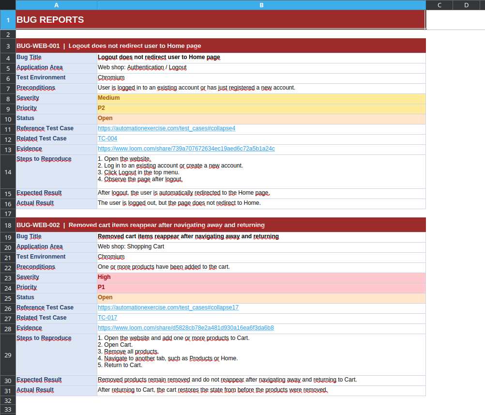

# Website Manual QA & API Testing

A QA portfolio project focused on manual functional testing of an e-commerce website and REST API testing using Postman. The project includes documented test cases, API test results, defect reports, and supporting evidence.

**Application:** [Automation Exercise](https://automationexercise.com/)  
**Testing types:** Manual Testing, API Testing  
**Browser:** Chromium  
**Operating system:** Fedora Linux 44  
**API testing tool:** Postman

## 1. Website Under Test

The project focuses on testing the functionality of an e-commerce website, including navigation, user authentication, product browsing, and shopping cart operations.

The following screenshots show the website used during testing.

## 2. Test Documentation

Test scenarios and execution results are documented in an Excel workbook. The documentation is organized into separate sheets to make test coverage, execution status, and identified defects easy to review.

### Project Overview

The overview summarizes the project, testing environment, and execution results.

### Manual Web Test Cases

The web test cases cover key website functionality, with expected results, actual results, and execution statuses recorded for each scenario.

**Total documented web test cases: 26**

### API Test Results

API test results document the requests performed, expected behavior, actual responses, and test status.

**Total API requests: 14**

## 3. API Testing with Postman

A dedicated Postman collection was created to validate the application's API endpoints and their behavior under different conditions.

The collection covers:

- Products and brands endpoints
- Product search
- Login verification
- Account creation, deletion, and updates
- Unsupported HTTP methods
- Missing parameters and invalid input

The screenshot below shows the requests organized in the Postman collection.

Some scenarios could not be fully verified because valid login credentials were unavailable. The project also documents observed limitations of the demo API regarding data persistence.

## 4. Defect Reporting

Two defects were identified and documented during manual website testing.

### BUG-WEB-001 - Logout Redirection

After logging out, the user is not redirected to the Home page.

### BUG-WEB-002 - Removed Cart Items Reappear

Products removed from the cart reappear after navigating to another page and returning.

Each defect includes a description, reproduction steps, expected and actual results, and supporting evidence references.

Screen recordings demonstrating the defects are provided separately in the `evidence/` directory.

## 5. Tools Used

- **Postman** - API request execution and response validation
- **Microsoft Excel / LibreOffice Calc** - test documentation and defect tracking
- **Chromium** - manual website testing
- **Loom** - defect screen recordings
- **Git & GitHub** - version control and portfolio presentation

## 6. Skills Demonstrated

- Writing and executing manual test cases
- Validating expected and actual results
- Identifying, reproducing, and documenting defects
- Testing REST API endpoints and HTTP methods
- Validating response status codes and data
- Testing missing parameters and invalid inputs
- Maintaining structured QA documentation
- Collecting and organizing test evidence
