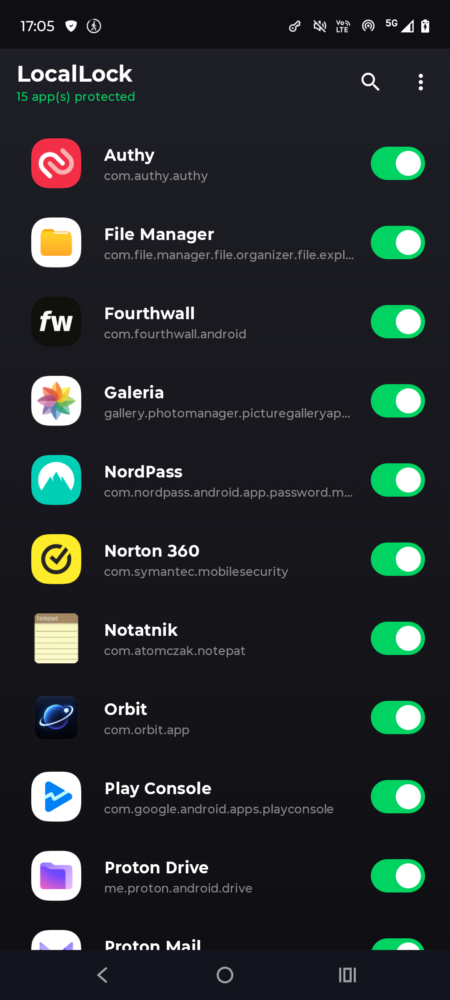
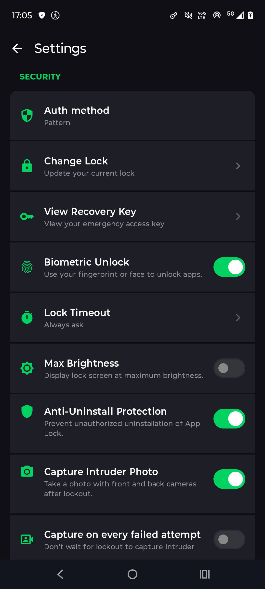
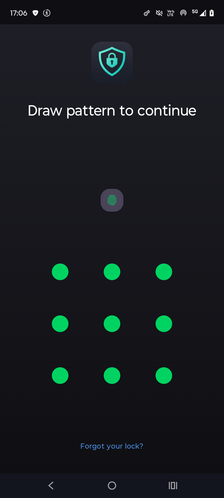
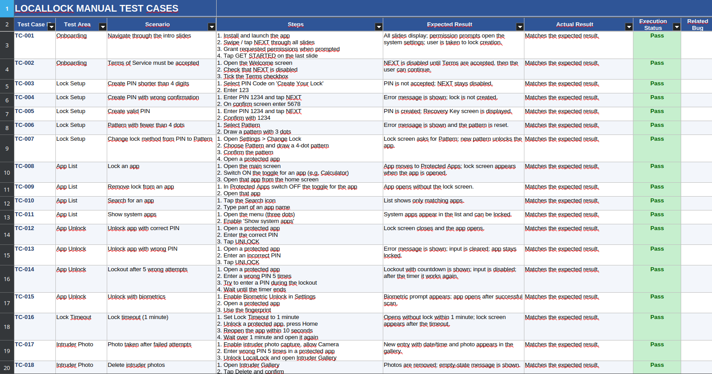

# LocalLock - Android Mobile Manual Testing

A manual QA testing project focused on **LocalLock**, an Android application designed to protect apps and improve user privacy.

The project documents manual test scenarios, expected results, actual results, and execution statuses in an Excel workbook.

**Application:** LocalLock  
**Google Play:** [Download LocalLock](https://play.google.com/store/apps/details?id=com.locallock.app)  
**Platform:** Android  
**Testing type:** Manual Functional Testing  
**Documentation:** Microsoft Excel / LibreOffice Calc

## 1. Application Overview

LocalLock is an Android app locker application. The screenshots below show the application interface and selected screens used during testing.

## 2. Manual Test Cases

Manual test cases were documented in Excel, covering onboarding, lock setup, input validation, and other application features.

The test documentation includes:

- Test Case ID and test area
- Test scenario and execution steps
- Expected and actual results
- Execution status
- Related bug reference, where applicable

**Total test cases:** 26  
**Execution results:** 26 Passed

The screenshot below shows a section of the test case documentation.

## 3. Test Documentation

The Excel workbook contains three sheets:

| Sheet | Description |
|---|---|
| `Project Overview` | Application details and testing information |
| `Test Cases` | Manual test scenarios and execution results |
| `Bug Reports` | Defect documentation |

No defects were recorded in the bug report sheet during this test run.

## 4. Testing Focus

- Onboarding and navigation
- PIN and pattern setup
- Input validation
- Application locking and unlocking
- Permissions and Android system behavior
- Privacy and security-related scenarios

## 5. Tools Used

- **LocalLock** - application under test
- **Android** - testing platform
- **Excel / LibreOffice Calc** - test documentation
- **Git & GitHub** - version control and portfolio presentation

## Skills Demonstrated

- Manual test case design and execution
- Positive and negative testing
- Validation of expected versus actual results
- Android application testing
- QA documentation and test reporting

**Project type:** QA Portfolio Project  
**Target role:** Junior QA Tester / Software Tester

