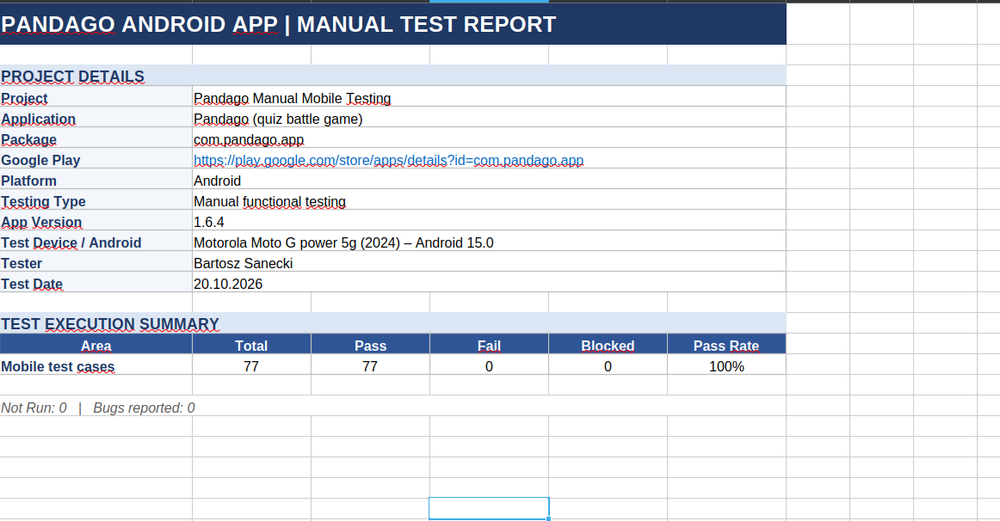
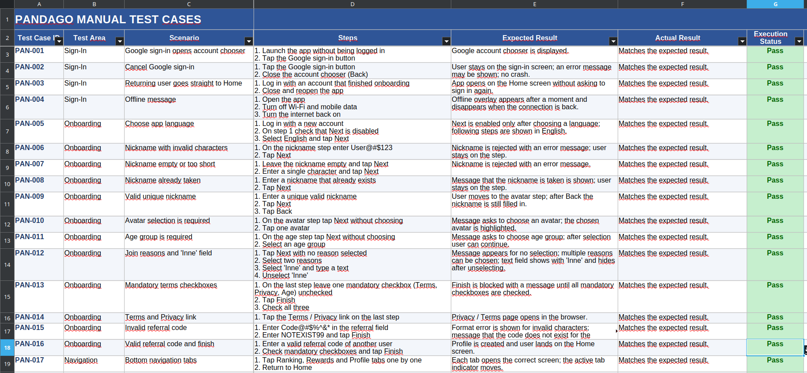

# Pandago — Android Manual Testing

Manual functional testing of **Pandago**, an Android quiz battle game.

## Project Information

| Item | Details |
|---|---|
| Application | Pandago |
| Google Play | [Pandago on Google Play](https://play.google.com/store/apps/details?id=com.pandago.app) |
| App Version | 1.6.4 |
| Test Device | Motorola Moto G power 5G (2024) |
| Android Version | Android 15 |
| Testing Type | Manual Functional Testing |

## Test Execution Summary

The manual test suite contains **77 test cases** covering the application's main features and user flows.

| Metric | Result |
|---|---:|
| Total Test Cases | 77 |
| Passed | 77 |
| Failed | 0 |
| Blocked | 0 |
| Pass Rate | 100% |
| Defects Reported | 0 |

## Test Report

The following screenshot shows the project details and the overall test execution summary.



## Test Cases

The test case workbook documents individual scenarios, execution steps, expected results, actual results, and execution status.



### Test Documentation

Workbook: `Pandago_Manual_Test_Cases.xlsx`

| Worksheet | Description |
|---|---|
| `Project Overview` | Application details, test environment, and execution summary |
| `Test Cases` | Test scenarios, steps, expected and actual results, and execution status |
| `Bug Reports` | Defect documentation |

## Test Coverage

The test suite covers the following application areas:

- **Sign-in and connectivity:** Google sign-in flow and offline behavior
- **Onboarding:** Language selection, nickname validation, avatar selection, age group, reasons for joining, terms, and referral codes
- **Navigation:** Home screen and navigation between application sections
- **Ranked Quiz Battle:** Matchmaking, questions, timer, Second Chance, and tie-breaker
- **Match Results and Rewards:** Results screens and reward flows
- **Play with Friends:** Invitations, friend requests, and referral codes
- **Rankings and Profile:** Rankings, profile, settings, and account deletion
- **Rewards and Engagement:** Rewards store, Lucky Wheel, daily tasks, and VIP subscription

## Skills Demonstrated

- Manual test case design and execution
- Positive and negative testing
- Input validation
- Testing multiplayer and real-time features
- Android application testing
- Test reporting and QA documentation

## Project Structure

```text
01_Manual_Testing/
├── screens/
│   ├── screen_1.png
│   └── screen_2.png
├── Pandago_Manual_Test_Cases.xlsx
└── README.md
```

## Test Outcome

All 77 test cases are recorded as passed, with no defects reported during this test run. These results reflect the tested application version and device configuration documented above.
