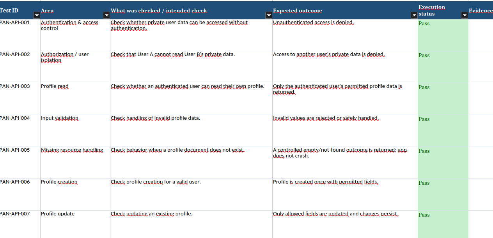

# 02 - Pandago API Testing

## Project Overview

This project documents API and backend testing scenarios for **Pandago**, an Android quiz application. The goal is to demonstrate a structured approach to identifying potential issues related to authentication, authorization, data validation, data integrity, and backend error handling.

The test scenarios are documented in an Excel spreadsheet, which serves as the main project artifact.

## Project Contents

```text
02_API_Testing/
├── screens/
│   └── screen_1.png
├── Pandago_API_Testing_Summary.xlsx
└── README.md
```

## Test Documentation

The Excel spreadsheet contains 20 API and backend test scenarios covering areas such as:

- Authentication and access control
- User data privacy and authorization
- Profile creation, retrieval, updating, and deletion
- Input validation and malformed data handling
- Query filtering and sorting
- Concurrent updates and transaction failures
- Protection of restricted fields
- Network and backend error handling
- External API integrations
- Least-privilege access control

## Test Cases Preview

The screenshot below shows a portion of the documented test scenarios in the Excel spreadsheet.



## Security and Confidentiality

For security reasons, detailed API request definitions and implementation-sensitive information are intentionally excluded from the public portfolio.

This includes raw request and response payloads, authentication headers, credentials, and sensitive endpoint details. The documentation focuses on test objectives, expected behavior, and testing scope without unnecessarily exposing the application's backend implementation.

## Tools and Skills Demonstrated

- API and backend testing concepts
- Test case design and documentation
- Authentication and authorization testing
- Input validation and negative testing
- Data integrity and access control
- Security-conscious test documentation
- Microsoft Excel
