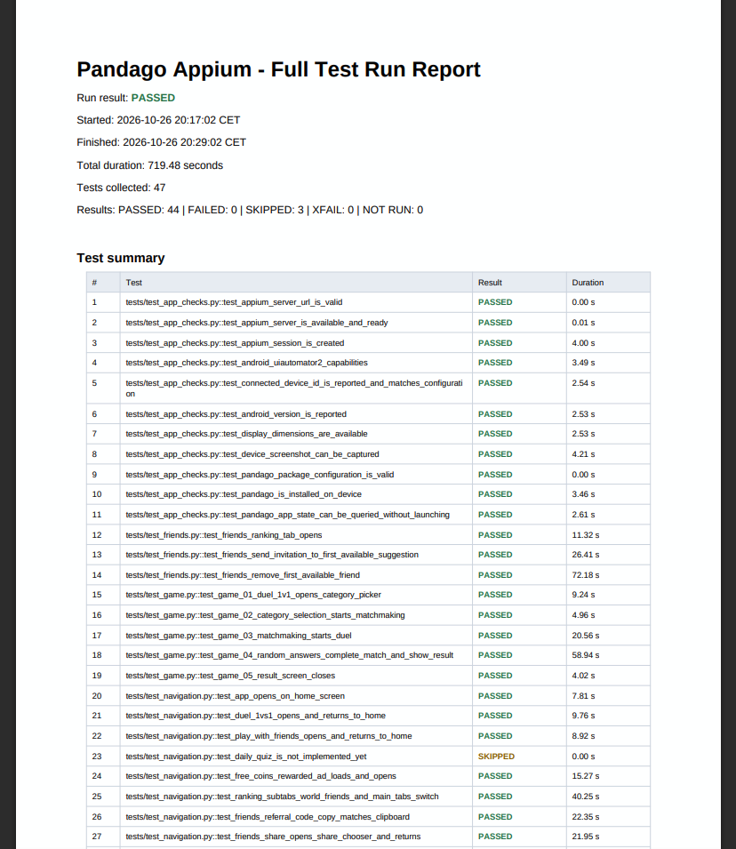
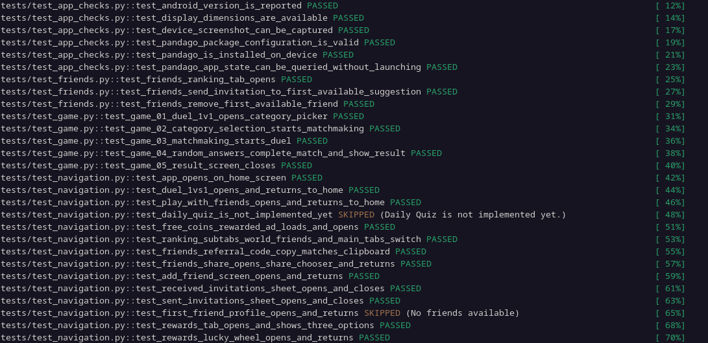

# 03 - Pandago Appium Automation

Automated UI testing of **Pandago**, an Android quiz battle game, using **Appium**, **UiAutomator2**, and **pytest**.

## Project Information

| Item | Details |
|---|---|
| Application | Pandago |
| Google Play | [Pandago on Google Play](https://play.google.com/store/apps/details?id=com.pandago.app) |
| Package | `com.pandago.app` |
| Platform | Android (real device) |
| Automation Stack | Python, [Appium](https://appium.io/), [UiAutomator2](https://github.com/appium/appium-uiautomator2-driver), [pytest](https://docs.pytest.org/) |
| Testing Type | Automated Functional / Smoke Testing |

## Test Execution Summary

The automated suite contains **47 tests**. The latest full run took about 12 minutes.

| Metric | Result |
|---|---:|
| Total Tests | 47 |
| Passed | 44 |
| Failed | 0 |
| Skipped | 3 |
| Total Duration | 719 s |

Three tests were skipped by design: Daily Quiz (feature not implemented yet), Lucky Wheel spin (24-hour cooldown active), and friend profile (no friends on the test account).

## Test Report

Each run generates a PDF report in `reports/<timestamp>/` with an overall summary, a per-test result table, and execution phases (setup, call, teardown).

Sample report from the latest run: [report.pdf](reports/2026-10-26_20-17-02/report.pdf)

<a href="screens/screen_1.png"></a>

The console output of the same run:

<a href="screens/screen_2.png"></a>

## Test Coverage

| File | Tests | Scope |
|---|---:|---|
| [`test_app_checks.py`](tests/test_app_checks.py) | 11 | Appium server status, session creation, UiAutomator2 capabilities, device and Android version, screenshot capture, app installation and state |
| [`test_game.py`](tests/test_game.py) | 5 | 1v1 duel: category picker, matchmaking, answering all 8 questions at random, result screen |
| [`test_friends.py`](tests/test_friends.py) | 3 | Ranking tab, sending a friend invitation, removing a friend |
| [`test_navigation.py`](tests/test_navigation.py) | 28 | Home, game modes, rewarded ad, Ranking, Friends hub, Rewards, Profile |

Highlights from [`test_navigation.py`](tests/test_navigation.py):

- **Friends:** referral code copied to the clipboard, share chooser, Add Friend screen, received and sent invitations
- **Rewards:** Lucky Wheel, VIP Shop, Daily Tasks
- **Profile:** avatar, nickname, nationality, gender, language switch (PL / EN), Help, Privacy Policy, Terms
- **Rewarded ad:** verified through `logcat` messages

## Test Design

- Bilingual locators, so the tests work with both Polish and English app interfaces
- Tests that change data restore the original state (nickname, language)
- No purchases, and account deletion is only opened and cancelled, never confirmed
- Smart skips when the account state does not allow a test (empty friends list, spin cooldown)
- Custom pytest plugin ([`pytest_pdf_report.py`](pytest_pdf_report.py)) that builds the PDF report with ReportLab

## Related Projects

- [01 - Manual Testing](../01_Manual_Testing/README.md)
- [02 - API Testing](../02_API_Testing/README.md)

## Project Structure

```text
03_Appium_Automation/
├── config/
│   └── settings.py
├── reports/
├── screens/
│   ├── screen_1.png
│   └── screen_2.png
├── tests/
│   ├── test_app_checks.py
│   ├── test_friends.py
│   ├── test_game.py
│   └── test_navigation.py
├── conftest.py
├── pytest.ini
├── pytest_pdf_report.py
├── requirements.txt
└── README.md
```

## How to Run

```bash
python -m venv .venv
source .venv/bin/activate
pip install -r requirements.txt

# Start the Appium server in a separate terminal, then:
pytest -v
```

Connection settings (Appium URL, device UDID, app package) are read from environment variables, see [`config/settings.py`](config/settings.py).

## Skills Demonstrated

- Mobile test automation with Appium and Python
- pytest fixtures, skips, and reusable helpers
- Locating elements by resource ID, text, and XPath
- Touch gestures and scrolling in a Jetpack Compose UI
- Testing real-time multiplayer flows
- Reading Android `logcat` output in tests
- Custom test reporting (PDF)

## Test Outcome

All 44 executed tests passed, with no failures. The 3 skipped tests depend on the app or account state and are marked with a reason in the report.
