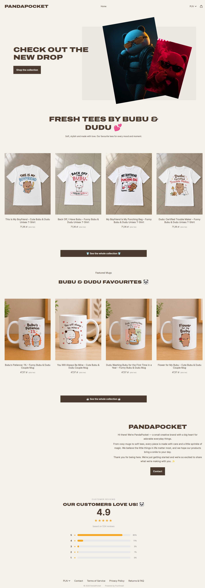

# QA & Test Automation Portfolio

**Bartosz Sanecki · Freelance QA Tester**

Hands-on QA projects covering manual testing, REST API validation, browser and Android automation, and API performance testing. The repository contains project documentation and practical evidence—test code, reports, test cases, and defect records—so recruiters can inspect the work behind each summary.

[Browse all projects](#portfolio-at-a-glance) · [Featured projects](#featured-projects) · [Skills](#skills-demonstrated) · [Test evidence](#test-evidence)


**Core areas:** test design and defect reporting · REST API testing and JSON Schema validation · Playwright UI automation · Appium Android automation · k6 performance testing · Python, pytest, and test reporting

## Featured projects

These three projects give a quick view of my automated testing work. The results below are snapshots from dated runs, not guarantees about the current state of external services.

### 1. [REST API Testing Framework](02_REST_API_Testing_Framework/README.md)

A Python test framework for six resources of the public JSONPlaceholder API. It covers response validation, JSON Schema contracts, parametrized scenarios, negative and boundary cases, and data-integrity checks across related resources.

- **Recorded result:** 156 passed, 0 failed; approximately 14 seconds in a local run on 17 October 2026.
- **Stack:** Python, pytest, Requests, jsonschema, pytest-html, allure-pytest.
- **Explore:** [test code](02_REST_API_Testing_Framework/tests/) · [schemas](02_REST_API_Testing_Framework/schemas/) · [saved report screenshot](02_REST_API_Testing_Framework/screens/screen_1.png)


*Saved pytest-html report from a local test run on 17 October 2026.*

### 2. [E-commerce UI Automation](03_E-commerce_UI_Automation/README.md)

A Playwright and pytest suite for a live Fourthwall storefront. It checks navigation, product pages and options, currency selection, collections, and shopping-cart journeys. The tests can open checkout, but they do not submit an order or make a payment.

- **Recorded result:** 130 passed, 0 failed in the saved run dated 18 October 2026. An earlier run recorded issues including a Contact link returning HTTP 404 and a duplicate product title.
- **Stack:** Python, Playwright, pytest, Chromium.
- **Explore:** [test code](03_E-commerce_UI_Automation/tests/) · [report before fixes (PDF)](03_E-commerce_UI_Automation/screens/report_1.pdf) · [report after fixes (PDF)](03_E-commerce_UI_Automation/screens/report_2.pdf) · [final HTML report](03_E-commerce_UI_Automation/reports/2026-10-18_19-34-25/report.html)



*Storefront evidence linked from the saved HTML report. The PDF and HTML files contain the test results and details.*

### 3. [Android Appium Automation — Pandago](05_Android_Mobile_Testing/03_Appium_Automation/README.md)

An Appium and pytest suite for the Pandago Android quiz game, executed on a real Android device. Coverage includes app navigation, quiz flows, friends and invitations, rewards, profile settings, language switching, and rewarded-ad checks using Android logs.

- **Recorded result:** 47 tests collected; 44 passed, 3 skipped by design, 0 failed, in the run on 26 October 2026.
- **Stack:** Python, Appium, UiAutomator2, pytest, ReportLab.
- **Test design:** Polish and English locators; changed profile data is restored; purchases and account deletion are not confirmed.
- **Explore:** [test code](05_Android_Mobile_Testing/03_Appium_Automation/tests/) · [PDF test report](05_Android_Mobile_Testing/03_Appium_Automation/reports/2026-10-26_20-17-02/report.pdf) · [Appium project structure and run instructions](05_Android_Mobile_Testing/03_Appium_Automation/README.md)


*First page of the PDF report generated by the project's custom pytest reporting plugin.*

## Portfolio at a glance

| Project | Scope | Documentation and evidence |
|---|---|---|
| **[01. Website Crawler & Broken Link Checker](01_Website_Crawler_Broken_Link_Checker/README.md)** | A Python desktop tool that crawls pages and checks links, redirects, response times, crawl depth, and optional JavaScript-rendered pages. Results can be exported to Excel. | [GUI screenshot](01_Website_Crawler_Broken_Link_Checker/docs/screenshots/website-scan.png) · [example Excel reports](01_example_reports/) · [unit tests](01_Website_Crawler_Broken_Link_Checker/tests/) |
| **[02. REST API Testing Framework](02_REST_API_Testing_Framework/README.md)** | Regression and contract checks for posts, users, comments, albums, photos, and todos in JSONPlaceholder. Write operations are simulated by the public API. | [tests](02_REST_API_Testing_Framework/tests/) · [schemas](02_REST_API_Testing_Framework/schemas/) · [report screenshot](02_REST_API_Testing_Framework/screens/screen_1.png) |
| **[03. E-commerce UI Automation](03_E-commerce_UI_Automation/README.md)** | Storefront navigation, product options, 17 currency options, T-shirt and mug collections, and cart operations. Checkout is opened but no order or payment is submitted. | [tests](03_E-commerce_UI_Automation/tests/) · [before-fix PDF](03_E-commerce_UI_Automation/screens/report_1.pdf) · [after-fix PDF](03_E-commerce_UI_Automation/screens/report_2.pdf) · [HTML report](03_E-commerce_UI_Automation/reports/2026-10-18_19-34-25/report.html) |
| **[04. Manual QA Documentation Suite](04_Manual_QA_Documentation_Suite/README.md)** | 122 documented test cases and 6 reported defects across The Dig Game, Automation Exercise (website/API), and the LocalLock Android app. The projects are independent practice work; confidential crowdsourced-testing materials are not included. | [The Dig Game workbook](04_Manual_QA_Documentation_Suite/01_Web_Game_Testing/The_Dig_Game_Manual_QA_Documentation.xlsx) · [website workbook](04_Manual_QA_Documentation_Suite/02_Website_Testing/Website_Manual_QA_Documentation.xlsx) · [Postman collection](04_Manual_QA_Documentation_Suite/02_Website_Testing/Automation%20Exercise%20-%20API%20Testing%20Suite.postman_collection.json) · [LocalLock workbook](04_Manual_QA_Documentation_Suite/03_Android_Mobile_Testing/LocalLock_Manual_Test_Cases.xlsx) |
| **[05. Android Mobile Testing — Pandago](05_Android_Mobile_Testing/README.md)** | One Android app tested through manual test cases, documented API/backend scenarios, and Appium UI automation. The API/backend material is scenario documentation, not an executable API test suite. | [manual test cases](05_Android_Mobile_Testing/01_Manual_Testing/Pandago_Manual_Test_Cases.xlsx) · [API scenarios](05_Android_Mobile_Testing/02_API_Testing/Pandago_API_Testing_Summary.xlsx) · [Appium automation](05_Android_Mobile_Testing/03_Appium_Automation/) |
| **[06. API Performance Testing with k6](06_API_Performance_Testing_k6/README.md)** | Smoke, load, and stress scenarios for three DummyJSON product endpoints, with 1, 5, and 10 virtual users, response checks, and p90/p95 thresholds. | [test code](06_API_Performance_Testing_k6/tests/) · [saved results](06_API_Performance_Testing_k6/results/) · [load comparison](06_API_Performance_Testing_k6/results/load_data/2026-10-27_00-46-09/load-comparison.md) |

## Skills demonstrated

**Manual testing and documentation**
- Test case design and execution, including positive, negative, and boundary scenarios.
- Exploratory testing and defect reports with reproduction steps, severity, priority, and supporting video evidence.
- Structured Excel documentation and traceability between test cases and defects.

**API testing and validation**
- REST API automation with pytest and Requests; response and JSON Schema validation.
- Parametrized tests, negative and edge cases, and data-integrity checks.
- Postman requests and documented backend test scenarios.

**Web and Android automation**
- Playwright with pytest for storefront flows, dynamic product discovery, assertions, screenshots, and reports.
- Appium and UiAutomator2 on a real Android device, bilingual locators, `adb logcat` checks, and cautious test-data handling.
- Python website-crawling and link-checking tool with unit tests written using `unittest`.

**Performance testing and reporting**
- k6 smoke, load, and stress testing with thresholds, tags, environment-based configuration, and Markdown/JSON reports.
- pytest fixtures, markers, skips, and custom HTML/PDF reports.
- GitHub Actions workflow experience for the performance-testing project; see the status note below.

## Test evidence and notes

- **Crawler:** [GUI screenshot](01_Website_Crawler_Broken_Link_Checker/docs/screenshots/website-scan.png) and [Excel scan reports](01_example_reports/).
- **REST API:** [pytest-html report screenshot](02_REST_API_Testing_Framework/screens/screen_1.png) and [terminal output](02_REST_API_Testing_Framework/screens/screen_2.png).
- **E-commerce:** [PDF before fixes](03_E-commerce_UI_Automation/screens/report_1.pdf), [PDF after fixes](03_E-commerce_UI_Automation/screens/report_2.pdf), and [final HTML report](03_E-commerce_UI_Automation/reports/2026-10-18_19-34-25/report.html).
- **Manual QA:** workbooks and defect recordings are linked from the [Manual QA project](04_Manual_QA_Documentation_Suite/README.md).
- **Android:** [Appium PDF report](05_Android_Mobile_Testing/03_Appium_Automation/reports/2026-10-26_20-17-02/report.pdf) and [report screenshot](05_Android_Mobile_Testing/03_Appium_Automation/screens/screen_1.png).
- **k6:** [load-profile comparison and raw result links](06_API_Performance_Testing_k6/results/load_data/2026-10-27_00-46-09/load-comparison.md). In this short saved run against a shared public mock API, the average response times were about 56–64 ms and all configured thresholds passed. These results are not a capacity benchmark.

**How to interpret the results**
- Results are from recorded local runs and can change when public sites, APIs, devices, or network conditions change.
- The REST API project can generate Allure results, but a generated Allure report is not committed here.
- The workflow YAML files stored inside the API and E-commerce project folders are not discovered as repository-level GitHub Actions workflows in this layout. The root performance workflow is manually triggered; the README does not claim that the API and UI suites currently run automatically in GitHub Actions.

## Repository structure

```text
01_QA-Portfolio/
├── 01_Website_Crawler_Broken_Link_Checker/
├── 01_example_reports/
├── 02_REST_API_Testing_Framework/
├── 03_E-commerce_UI_Automation/
├── 04_Manual_QA_Documentation_Suite/
├── 05_Android_Mobile_Testing/
├── 06_API_Performance_Testing_k6/
└── .github/workflows/
```

Each project folder contains its own README and relevant code or testing artefacts. See the individual project pages for setup instructions, detailed scope, and implementation notes.
